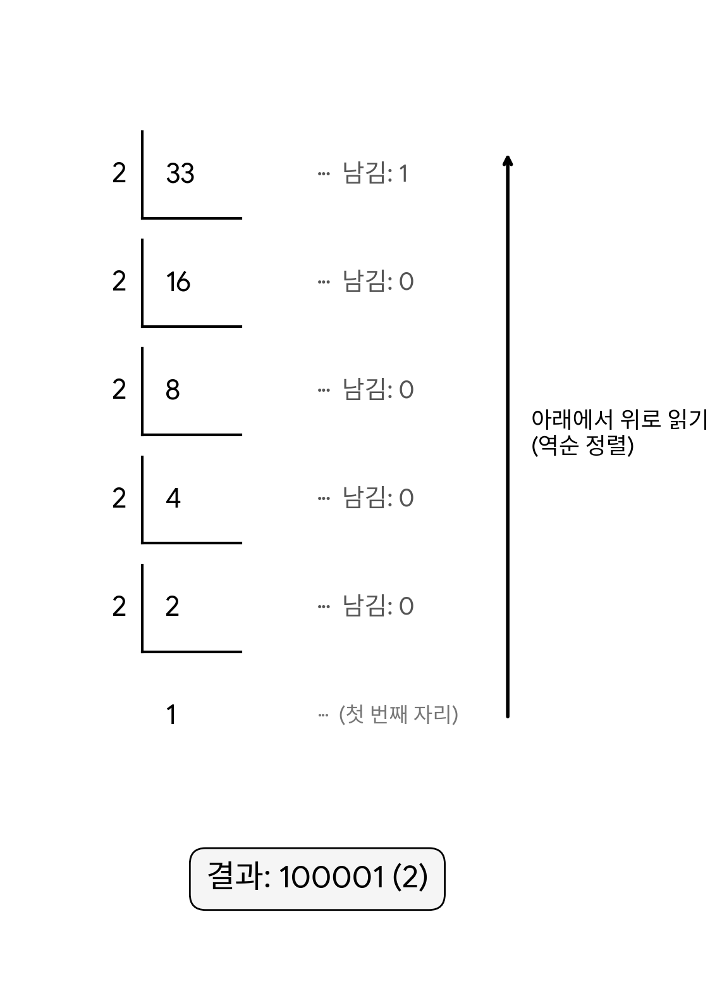
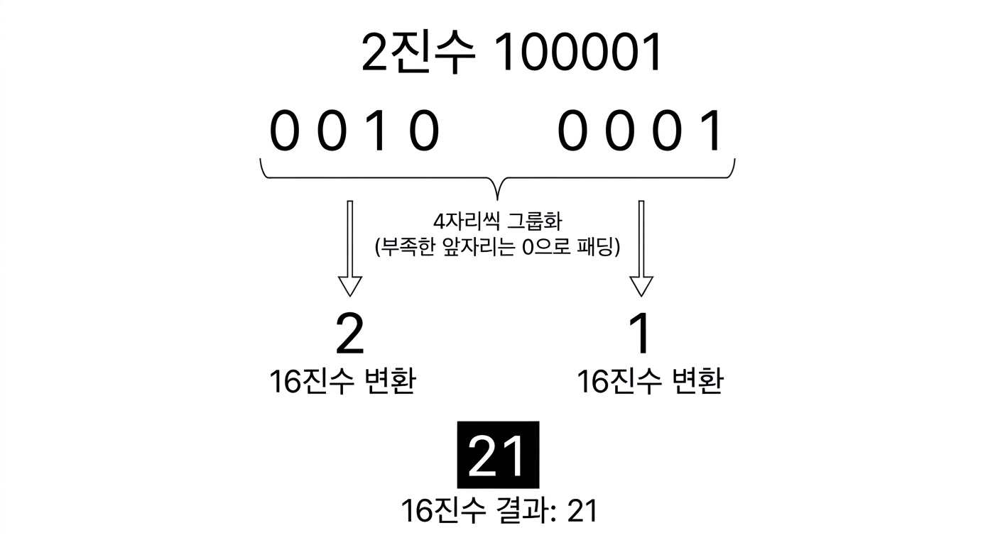

# 1주 1일차 - 하드웨어

<aside>

#### 오늘의 목표

CPU, RAM, 프로세스의 역할과 프로그램 실행 흐름 학습

### CPU : 명령어(Instruction Set) 해석기

#### CPU Archtecture의 종류

|  | CISC 방식(복잡) | RISC 방식(단순) |
| --- | --- | --- |
| 명령어 개수 및 길이 | 많음 / 가변 길이 | 적음 / 고정 길이 |
| 실행 속도 | 클럭당 처리 복잡, 상대적으로 느림 | 1클럭 중심, 매우 빠름 |
| 레지스터 개수 | 적음 | 많음 |
| 전력 소모 | 높음 | 낮음 |
| 주요 사용 분야 | 데스크톱, 노트북(PC) | 모바일(스마트폰), 서버, 임베디드 |
| 대표작 | intel의 x86-64 등 | ARM |

※ no-arch : 특정 아키텍처에 구애받지 않고 구동되는 소프트웨어 패키지.

#### VMware : ‘가상’의 ‘머신’

물리장치를 파일로 취급하는 도구.

서로 호환 불가능한 아키텍처와 운영체제를 함께 사용할 수 있게 됨.

#### 디지털 표시(0과 1)의 용량

| 1 bit | bit |
| --- | --- |
| 4 bits | nibble |
| 8 bits | byte |
| 16 bits | WORD |
| 32 bits | DWORD |
| 64 bits | QWORD |

| Deca | 10^1 | Deci | 10^-1 |
| --- | --- | --- | --- |
| Hecto | 10^2 | Centi | 10^-2 |
| Kilo | 10^3 | Mili | 10^-3 |
| Mega | 10^6 | Micro | 10^-6 |
| Giga | 10^9 | Nano | 10^-9 |
| Tera | 10^12 | Pico | 10^-12 |
| Peta | 10^15 | Femto | 10^-15 |
| Exa | 10^18 | Atto | 10^-18 |
| Zetta | 10^21 | Zepto | 10^-21 |
| Yotta | 10^24 | Yocto | 10^-24 |

#### 진수 변환법

- 10진수 ↔ 2진수 ↔ 16진수
    
    
    
    
    

#### 오류 검출을 위한 Checksum

- 데이터 패킷
    
    
    | Header | Body | Tail |
    | --- | --- | --- |
    | Checksum [Parity bit / CRC] |  |  |
    
    Parity bit : 기본 데이터 8bits에 1bit 추가하여 오류 검출
    
    -odd parity : 1의 개수가 홀수 (보편적 사용)
    
    -even parity : 1의 개수가 짝수
    

#### RAM : ‘보조기억’장치

|  | DRAM | SRAM |
| --- | --- | --- |
| 데이터 저장 구분 | 휘발성 | 비휘발성 |
| 기본 구조 | 트랜지스터 1개 + 커패시터 1개 | 트랜지스터 6개 |
| 리프레시 여부 | 필요함 (수십 ms 주기) | 불필요함 |
| 접속 속도 | 상대적으로 느림 (수십 ns 수준) | 매우 빠름 (1ns 안팎 / L1 캐시는 수 사이클) |
| 집적도(용량) | 높음 (셀 면적이 작음) | 낮음 (셀 면적이 큼) |
| 비트당 가격 | 저렴함 | 비쌈 |
| 주요 용도 | PC 및 서버의 메인 메모리(RAM) | CPU의 캐시 메모리 (L1, L2, L3) |
- Cache : 이전 작업의 값 보관, CPU 호출 시 값 건넴.
- Buffer : /tmp와 같은 임시 저장공간.
- Swap : HDD “물리” 공간을 일부 RAM으로 사용하는 영역
- Virtual Memory : HDD와 RAM을 묶어서 관리하는 “논리” 기법

#### OS(Operating System)

- 프로세스 관리
- 메모리 관리
- 파일 시스템 관리(NTFS, ZFS, Ext4, …)
- 장치 입출력 관리
- 보안/보호 설정
- 네트워크 관리
- 자원(Resources: RAM, CPU, HDD) 할당과 관리
- 사용자 인터페이스(Interface : port, input/outout) 제공

#### Docker

애플리케이션을 코드, 실행 환경, 라이브러리와 함께 컨테이너(Container)라는 표준화된 단위로 패키징하여, 어디서나 일관되게 실행할 수 있게 해주는 오픈소스 가상화 플랫폼

- Container : <u>**운영체제 없이(OS-less)**</u> 미니 컴퓨터처럼 동작하는 서비스 환경
- Image : 컨테이너 실행을 위한 파일 설정값을 담아둔 ‘읽기 전용’ 템플릿(설계도)
- Docker file : 이미지 제작을 위한 프로그램 및 설정에 관한 조립 설명서(스크립트)
- Docker Hub : 도커 이미지 저장소
- MS Office 365가 대표적 예시

※ Ubuntu 운영체제에 Docker 설치, Ubuntu의 리소스 활용

주석

- 클럭 : CPU의 연산 속도 단위

- Windows의 Registry에서 단위 확인 가능 (regedit 실행)
- Registry : 하드웨어와 소프트웨어에 대한 정보 존재
- Control Panal(제어판) : Registry의 대표격

※ 트랜지스터와 커패시터

- 트랜지스터 : 전류의 흐름을 제어하는 ‘스위치’ 역할
- 커패시터 : 전기 전하를 “임시”로 저장해두는 ‘배터리’ 역할

※ CPU의 캐시메모리

레이어별로 나뉘어져서 CPU의 안팎에 존재, L1은 내부에, L2는 CPU 바로 옆에, L3는 CPU 근처에 존재한다. 

※ 가상 메모리와 스왑 메모리의 차이

- Virtual Memory : RAM과 HDD를 합쳐 더 큰 메모리처럼 보이게 만드는 “개념적 시스템”
- Swap Memory : 위의 Virtual Memory를 만들기 위해 빌려 쓰는 “실제 HDD 공간”
</aside>
