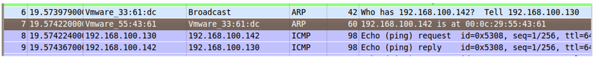
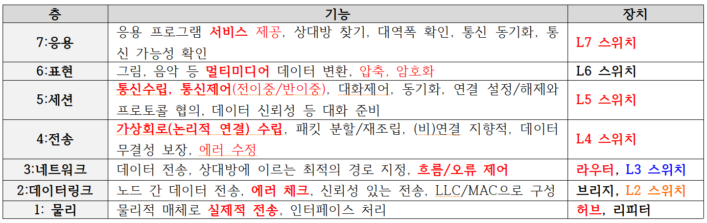
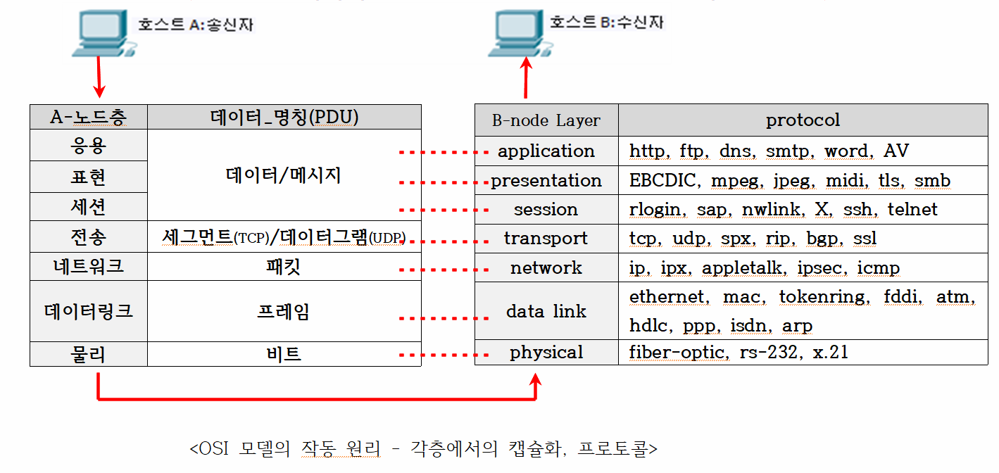
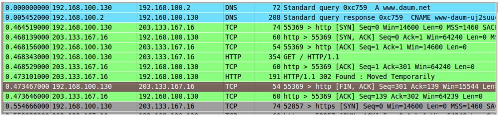

# 1주 2일차 - 네트워크

### ☆ 네트워크 원리와 구조 ☆

---

#### 네트워크

- 네트워크 범위 분류 (조직의 라우터 기준)
    - **LAN (Local Area Network) :** 라우터 이하(조직 내부)의 망. 부서 단위를 **세그먼트(Segment)**라 부름.
    - **WAN (Wide Area Network) :** 라우터 밖(조직 외부)의 전 세계적인 망.
    - **MAN (Metropolitan Area Network) :** 도시 규모의 망이나, 현재는 개념상 잘 사용하지 않음.
    
- 망 활용 형태
    - **인트라넷 (Intranet) :** 조직 내부 리소스를 외부 유출 없이 웹 브라우저(TCP/IP) 형태로 편리하게 서치하는 기법 (예: `\\192.168.100.12\data` 또는 `file:///C:/data`) 웹 브라우저가 인터넷 서핑만을 위한 것이 아님을 보여줌.
    - **익스트라넷 (Extranet) :** 인트라넷을 확장하여 협력사, 벤더, 유관기관, 고객 등 외부 관계자까지 웹 브라우저로 접속해 재택근무, 화상회의, 원격 작업(원격 공유/교육/수술)을 가능하게 한 환경.
    
    ---
    

---

#### 통신 규칙 및 서비스 제공 방식

- **프로토콜 (Protocol)**
    
    시스템/노드 간 통신을 위한 약속·규칙 (예: TCP, IP, FTP, DHCP, RIP, OSPF 등 1만 개 이상 존재). 한글 프로그램이나 코덱(Codec)처럼 상호 프로토콜이 일치해야 통신이 가능함.
    

<aside>
💡

- **독점 방지 (Non-proprietary) ★**
    
    과거 특정 제조사 장비끼리만 호환되던 방식을 '프로프리에터리(proprietary)'라고 함. 독점(Monopoly)의 폐해가 크므로 메인 회선 외에 백업 회선(KT 외 SK/LG)을 두거나 다양한 웹 브라우저(크롬, 엣지 등)를 골고루 사용하는 소비자/조직의 노력이 필요함.
    
</aside>

- 역할 및 구조 분담
    - **클라이언트 :** 서비스를 요청하는 호스트 (Windows Pro 버전만 도메인 가입 가능, Home 버전은 불가).
    - **서버 :** 서비스를 제공하는 호스트 (반드시 서버 전용 OS를 가질 필요는 없음).
    - **P2P (Peer-to-Peer) :** 양 노드가 동등하게 서버와 클라이언트 역할을 수행 (예: 강사 컴퓨터 파일 공유). 편리하지만 바이러스나 악성코드 침투에 취약함.
    
    ---
    

---

#### 주요 IT 용어 및 도메인 구조

- 장치 관련 명칭
    - **Host (호스트) :** NIC(랜카드)를 가진 네트워크 상의 컴퓨터 장치 (가장 널리 쓰임).
    - **Multi-homed Machine:** NIC를 여러 개 탑재하고 있는 호스트.
    - **Node (노드) :** NIC를 가진 모든 장치 (컴퓨터, 라우터, 스위치, 프린터, 플로터 등 포함).
    - **Workstation :** 조직의 도메인에 가입되어 있는 호스트 (FQDN 형식으로 표현, 예 : `win7@kahn.edu`).
    - **애칭 :** 컴퓨터를 Box, Can, Machine 등으로 부르기도 함.
    
- 도메인 (Domain) 공간 예시 (**`kahn.edu`** 가상 공간)
    
    `www.kahn.edu` (웹 서버)
    
    `ftp@kahn.edu` (파일 서버)
    
    `mx@kahn.edu` (Mail eXchanger 메일 서버)
    
    `hong@kahn.edu` (사용자/이메일 주소)
    
    ---
    

---

#### 네트워크 장비 및 케이블 링크 규격

- **주요 벤더 :** 시스코(Catalyst 시리즈 등), HP, 쥬니퍼, 화웨이, 아이피타임 등 (명령어는 달라도 개념은 동일).
    
    
- **매체(케이블) 종류 :** 광케이블(Fiber Optic), STP, UTP, 동축케이블(Coaxial) 및 무선(Laser/LED 가시광선을 사용하여 공기를 매체로 전송).
    
    

<aside>
💡

- WAN 인터페이스 용어 ★
    - **DCE :** ISP/CO(전화국) 측 장비. 대역폭(Clock rate, Bandwidth)을 조직에 공급함.
    - **DTE :** 조직 내부 측 장비(Premise: Area, Zone). DCE가 공급하는 대역폭을 그대로 수용함.
    - **CSU/DSU :** WAN의 아날로그 신호와 내부의 디지털 신호를 상호 변환(Modulation+Demodulation: 모뎀 역할)하는 장치.
    - **Demarc (Demarcation) :** 외부 선로와 조직 내부 망이 만나는 경계점 (장애 발생 시 책임 소지 분기점).
    - **Local Loop :** WAN에서 조직 LAN으로 들어오는 물리적 경로.
</aside>

- **핵심 장비별 특성 비교**
    
    
    | 장비명 | 통신 레이어 및 특징 | 도메인 분리 특성 |
    | --- | --- | --- |
    | Hub | **L1 (물리)** 장비. 입력 대역폭을 포트 수만큼 분할 배포 (속도 저하) | 모든 포트가 하나의 **충돌 도메인(Collision Domain)**에 속함. 브로드캐스트 수신. |
    | Switch | **L2 (데이터링크)** 장비. 대역폭 분할 없이 고속 전송. MAC 주소 기반 통신. **Port Security, VLAN 설정**이 핵심. AI 발전으로 AGI 논의와 연관. | **각 포트별로 충돌 도메인을 독립적으로 분리**함. 브로드캐스트 수신. |
    | Bridge | **L2 (데이터링크)** 장비. 대학 건물 동 간 연결 등에 특화됨. | 됨.논리적으로 **2개의 브로드캐스트 도메인**으로 분리. 브로드캐스트 수신. |
    | Router | **L3 (네트워크)** 장비. 최적의 경로(Route) 지정 및 **서로 다른 네트워크 연결**. LAN 포트는 Gateway(Fast/Gigabit Ethernet)가 되고 WAN 포트는 Serial 포트가 됨. | 충돌 도메인 유입 차단, **브로드캐스트(Broadcast) 완전히 차단** |
    
    ---
    

---

#### 주소 체계와 서브네팅 (Subnetting)

- **ARP (Address Resolution Protocol) :** 내부 LAN 통신을 위해 IP 주소를 바탕으로 상대방의 고유 하드웨어 주소인 MAC 주소를 알아내는 프로토콜 (`arp -a` 명령으로 매핑 테이블 확인 가능).
    
    
    
- **IP 주소 (32비트 소프트웨어 주소) :** 가변적임.
    - **디폴트 Class C (`/24`) :** 서브넷 마스크 `255.255.255.0`, 할당 가능한 IP는 총 256개이지만 실무상 가용 호스트 IP는 **254개** (호스트 비트가 전부 0인 네트워크 주소와 전부 1인 브로드캐스트 주소 제외).
    - **서브네팅된 상태 (`/30`) :** 서브넷 마스크 `255.255.255.252`, 네트워크 비트를 30으로 확장하여 호스트 비트가 2비트만 남음. 총 4개의 IP 중 네트워크/브로드캐스트 주소를 제외하면 **가용 호스트 IP는 딱 2개**가 됨. IP 낭비를 최소화하기 위해 실무에서는 **라우터 간 1:1 직결(WAN 구간)**에 전용으로 쓰임.
    - **네트워크 판단 방법 :** IP 주소와 서브넷 마스크를 비트별 **AND 연산(ANDing: 1&1=1, 그 외 0)** 하여 결과값이 같으면 동일 네트워크, 다르면 타 네트워크로 판정. 서로 다른 서브넷 간에는 반드시 라우터를 거쳐야 통신 가능.
    
- **MAC 주소 (48비트 하드웨어 주소) :** 비가변적 성격(단, ARP 스푸핑 공격으로 변조될 우려 있음). 16진수 구조(예: `1c`는 8비트이며 `0001 1100`을 의미).
    - **전반 24비트 (OUI) :** 제조사/벤더 식별 코드 (Cisco: `00-00-0C`, LinkSys: `00-E0-98`, 3Com: `00-10-5A`). 벤더명과 후반 주소를 조합해 `Cisco-AA:BB:CC` 형태로 표기하기도 함.
    - **후반 24비트:** 제조사에서 부여한 고유 시리얼 번호.

---

#### 데이터 전송 방식 및 이더넷 케이블 배열

- 통신 방식 및 캐스트 분류
    - **Baseband :** LAN 환경, 디지털 신호, 단거리, 양방향, 단일 채널, **TDM(시분할)** 방식 사용.
    - **Broadband :** WAN 환경, 아날로그 신호, 장거리, 단방향, 다중 채널, **FDM(주파수분할)** 방식 사용.
    - **Broadcast (브로드캐스트) :** 망 내 무작위 모든 노드에게 전송하는 방식 (**필요악**으로 표현됨).
    - **Multicast (멀티캐스트) :** 지정된 특정 그룹 노드들에게만 전송.
    - **Unicast (유니캐스트) :** 1:1로 지정된 단 하나의 노드에게만 전송.
    - **Anycast (애니캐스트) :** IPv6에서 브로드캐스트 대신 사용. 범위 내 노드 중 가장 먼저 응답하는 노드와 통신.
    

<aside>
💡

- **Collision Domain :** 동시에 두 개 이상의 장치가 데이터를 보냈을 때 데이터 충돌(Collision)이 발생할 수 있는 네트워크 범위 ★
    - **허브(Hub)**와 콜리전 도메인 : 공유 도로
        - 허브는 들어온 신호를 모든 포트로 그대로 복제해서 뿌리는 '더미(Dummy)' 장비
        - 허브에 연결된 **모든 PC는 하나의 콜리전 도메인**에 속함.  한 PC가 데이터를 보낼 때 다른 PC가 동시에 보내면 충돌이 일어남. 전체 대역폭(예: 100Mbps)을 여러 컴퓨터가 나누어 쓰기 때문.
    - **스위치(Switch)**와 콜리전 도메인 : 전용 차선
        - 스위치는 MAC 주소를 기억하여 목적지 장치에만 데이터를 1:1로 정확하게 전달하는 장비
        - 스위치는 **포트 하나당 하나의 독립된 콜리전 도메인**을 가짐. 따라서 다른 포트에서 무슨 데이터를 보내든 서로 충돌이 발생하지 않으며, 그림처럼 모든 PC가 각각 온전한 100Mbps의 대역폭을 보장받음.
</aside>

- **다중 접속 매체 제어 (MAC)**
    - **CSMA/CD :** 유선 이더넷 환경에서 사용. 신호 감지 후 동시 접근 시 충돌을 감지(Collision Detection)하고 재전송하는 구조로 노드 간 충돌 가능성이 있음.
    - **CSMA/CA :** 무선 통신 환경에서 사용. 사전에 충돌을 회피(Collision Avoidance)하여 통신함.
    
- RJ-45 이더넷 케이블 가닥 배열 (핀 규격)
    
    <aside>
    💡
    
    - **Auto-MDI/MDI-X :** 현대 장비들은 포트가 케이블 배열(Homo/Hetero)을 스스로 감지하여 핀을 자동으로 정렬해 주므로 **실무에서는 다이렉트 케이블 하나만으로도 대부분 통신이 가능함**. 단, 이론적/자격증 시험 규격은 아래와 같음. **★**
    </aside>
    
    - **동종 장비 간 연결 (Homo Device: 라우터 ↔ 라우터, 스위치 ↔ 스위치, 라우터 ↔ PC, PC ↔ PC) >> 크로스 케이블 (Cross-over)**
        - 한쪽: 줄녹 - 녹색 - 줄주 - 파랑 - 줄파 - 주황 - 줄갈 - 갈색
        - 반대쪽: 줄주 - 주황 - 줄녹 - 파랑 - 줄파 - 녹색 - 줄갈 - 갈색
    - **이종 장비 간 연결 (Hetero Device: 라우터 ↔ 스위치, 스위치 ↔ PC) >> 다이렉트 케이블 (Straight-thru)**
        - 양쪽 모두 동일하게 정배열: 줄주 - 주황 - 줄녹 - 파랑 - 줄파 - 녹색 - 줄갈 - 갈색

---

#### OSI 7 Layer 장비 매핑 및 핸드셰이크 보안

- **OSI 7 Layer**
    - **계층별 장비 및 PDU(Protocol Data Unit) 명칭**
        
        
        
    - **OSI 모델의 작동 원리**
    
    
    
- **핸드셰이크 (Handshakes) 메카니즘 및 DoS 공격**
    - **연결 방식 구조**
        - **3-way handshake :** 일반적인 유선/TCP 통신의 안정적인 세션 연결 과정.
            
            
            
        - **2-way handshake :** 무선 환경에서의 연결 과정.
        - **4-way handshake :** TCP 통신을 정상적으로 종료(해제)하는 과정.
    - **보안 위협 (DoS 공격) :** TCP의 3-way handshake 초기 연결 단계를 악용하여 서버 자원을 고갈시키는 DoS(서비스 거부) 공격이 많음.
        - **SYN Flooding 공격 원리 :** 공격자가 서버에 연결 요청(**SYN**)만 계속 보내고, 서버가 수락 응답(**SYN-ACK**)을 보냈을 때 최종 확인(**ACK**)을 고의로 보내지 않아 서버의 연결 대기 큐(Queue)를 꽉 채워 마비시키는 방식.
        - **기타 공격 유형 :** Smurf, Land Attack, Ping of Death 등.

※ 주석 ※

** 좌측의 내용은 인공지능 Chat GPT와 함께 작성한 내용입니다. **

---

### ★ 오늘 새로 알게된 내용 ★

<aside>
❗

**프로프리애터리**

하나의 제조사가 자기 장비들끼리만 호환되게 함. 이러한 독점을 막기 위해 소비자, 조직 등의 노력이 필요하다고 함.

</aside>

<aside>
❗

**WAN 인터페이스 용어**

- **DCE :** 대역을 ‘공급’하는 역할.
- **DTE :** DCE가 공급하는 대역을 ‘수용’하는 역할.
- **CSU/DSU :** 모뎀 역할. 아날로그 ↔ 디지털
- **Demarc  :** 내외부 경계. **(장애 발생 시 책임의 경계)**.
- **Local Loop :** WAN에서 LAN으로 들어오는 물리 경로.
</aside>

<aside>
❗

**실무 현장에서의 케이블**

이론상으론 크로스 케이블이나 다이렉트 케이블이 존재하지만, 실제 실무에서는 다이렉트 케이블 하나로도 대부분 오류 없이 연결됨.  포트가 핀을 감지하여 자동으로 정렬한다고 함. 🫢

</aside>

### ◎ 더 찾아본 내용 ◎

<aside>
🔎

**서브넷은 왜 쓰는걸까?**

구분하고 분리하면 관리하기 쉽다는 생각은 드는데, 다른 이유도 있지 않을까?

많은 이유가 있는데, 일단

1. 브로드캐스트 스톰 방지
    
    브로드캐스트로 신호를 보내면 브로드캐스트가 속한 서브넷 전체에 신호 뿌려짐 → 서브넷 크기가 크면 엄청 많이 뿌려짐 → 전체 네트워크 마비로 이어짐 >>서브넷 있으면 처리해야하는 양 줄어드니까 서브넷 있어야 함.
    
2. IP 주소 낭비 방지
    
    주소 부족해서 IPv6까지 만들었다.. 라우터같이 여유 주소가 굳이 필요하지 않은 경우까지 많은 주소를 부여해두면 너무 많이 낭비된다. 그래서 서브넷 쓴다.
    

루프백 IP가 뭘까?

나를 가리키는 특수 IP라고 한다.

내 컴퓨터 환경 안에서 프로그램끼리 통신할 때 사용한다.

나 자신에게 `ping`을 날려 NIC 및 프로토콜 스택 정상 작동 테스트 시에도 사용한다. `Reply` 나오면 멀쩡하다는거다.

절대 죽지 않는 장비 고유의 ip를 부여한다고 한다. 전기 공급만 문제 없으면 절대 변하지 않는 ip로 마스터키 역할을 하게 한다.

필요 없는 것은 없다… 😂

</aside>

## ♤ 실무를 위해 꼭 기억하자 (Only for me)♤

<aside>
🧠

**트러블 슈팅시 OSI 7계층 점검은 하위부터 상위순으로!**

Ex) 케이블 링크 불 들어왔나?(L1) → 상대방 MAC 주소 올라오나?(L2) → 게이트웨이로 ping 나가나?(L3) → 포트 열렸나?(L4)

** `ping` 안 가도 통신 되는 경우 있다!

`ping`은 ICMP로 확인한다, 하지만 기업이나 공공기관의 방화벽과 서버는 신호를 차단해두는 경우가 있다! (Ping of Death(과거에 주로), ICMP Flooding(현대에 주로) 같은 ICMP 기반 네트워크 공격도 막고, 또 IP 생존여부를 숨겨서 IP가 살아있는가?를 모르게 하겠다는건데… ~~그럼 `ping` 없이 어떡하라고 하던 찰나에~~ `curl -v`나 `telnet [IP] [PORT]` (포트 스캔 명령어)로 **L4 계층의 포트가 실제로 열려있는지 확인**이 가능하다고 한다. ~~(근데 그럼 해커도 그 방식.. 쓸 수 있는거 아닌가..?)~~

>>결국 궁금해서 찾아봤더니 핑은 길 하나만 스윽 다녀오는거라면 포트스캔은 서버에 존재하는 문은 다 두드리는거라 오래걸린다고 한다. 거기에 더해 핑은 핑을 썼다는 흔적이 거의 없는 반면에 포트스캔은 공격 흔적이 선명하게 남아서 해커들이 선호하지 않는다고 한다! 😆

</aside>

<aside>
🧠

**IP 할당 및 서브네팅 실무**

IP 할당은 네트워크 주소랑 브로드캐스트 주소 빼고!

‘/30’을 강사님이 예시로 드셔서 이거 실제로 쓰는건 2갠데 실무에서 자주 쓰이나? 하고 찾아봤는데! 라우터끼리 혹은 방화벽과 라우터 사이를 1:1로 직결할 때 IP 낭비를 막기 위해 쓴다고 한다. ‘/32’도 쓴다고 한다! 장비 자체의 관리용 주소인 루프백 IP를 설정할 때 사용한다고 한다. 이 부분은 궁금해서 더 찾아봤다! 찾아본 내용에 적었다! 

서브네팅 계산하는건 네관사 할 때도, 정처기 할 때도 암기가 안 돼서 그냥 날 잡고 아예 파헤친 적이 있어서 잊히지 않는다.. 

</aside>

<aside>
🧠

**물리적 인프라 및 케이블링 실무**

**케이블 크게 신경 안 써도 됨**

최근 실무에서는 과하게 노후화된 장비 아니면 케이블 아무거나 꽂아도 알아서 정상화 된다고 한다. **Auto-MDI/MDI-X** 기능이라고 한다.

**디마크** 위치 확인

아무래도 이론이 아니라 실제상황이니까.. 사고 터지면 누가 수습해야 하는지 구별할 필요가 있겠구나 하는데, 맞았다. 중요한 거 맞는 것 같다. 😂

</aside>

<aside>
🧠

**네트워크 보안 및 아키텍처 실무**

**VLAN 사용**

네트워크 같은 스위치 아래 장비 많으면 위에서 봤던 브로드캐스트 스톰 일어날 수 있으니 스위치에서 필히 VLAN 활용하여 브로드캐스트 도메인의 크기 유지 필요!!

**Windows Home 경계**

이거 수업중에 잠깐 들었던 것 같은데, 사내 망 구축시 임직원 OS가 Home 버전이면 도메인 가입이 안됨. 중앙 제어 및 보안 정책 적용 전부 안됨. 무조건 Pro 이상이어야 함!

</aside>
