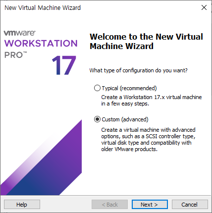

# Ubuntu of Linux with VMware

오늘은!! CLI의 꽃!! 리눅스 계열의 우분투를 가상머신에 설치하고 네트워크를 열어 외부 도메인에 접속해볼 것이다!!

## 1. Ubuntu 설치하기

윈도우 설치시에는 Typical을 이용했지만, 우분투는 리눅스 계열이므로 Custom을 사용했다.

OS도 윈도우는 함께 설치했던 것과 달리, 우분투는 나중에 꽂기로 하고 넘어간다.

그래도 눈치를 준다. 나중에 무얼 꽂을 것인지 묻는다. 우분투 64비트를 설치해줄 것이기 때문에 Ubuntu 64-bit를 선택해준다.

버츄얼 머신 이름을 짓고 저장소를 지정해준다. U’bun’tu라서 버니라고 지어줬다.

CPU 개수와 코어 개수를 지정하는 창이다. 테스트 용이니 각각 1과 2를 지정해준다.

네트워크를 고르는 창이다. 향후 서버로 활용해야 하고, 외부와 통신이 이뤄져야 하므로 NAT를 사용한다. (가상머신의 서버를 위한 네트워크는 거의 NAT를 쓴다고 보면 된다.)

최근은 사타를 많이 사용하지만, 아직 서버에서는 스커지를 쓰는 경우도 많다.

디스크 사이즈는 40으로 준다. 여기서 하나 보고 넘어가야 할게 있다. Store virtual ~ 과 Split virtual ~ 이다. 전자는 디스크를 한 덩어리로 두고, 후자는 쪼개어 둔다. 저장해둔 데이타를 찾을 때에는 후자가 더 좋다고 한다. 예상컨데, DB처럼 정렬하여 인덱스나 기본키를 통해 찾는 시간을 단축하는 알고리즘이 아닐까 싶다.

<aside>
💡

속도보다는 타 디스크로 데이타 이동 시에 훨씬 더 효율적이라는 답을 찾았다.

</aside>

이외에도 많은 설정을 마치고 셋팅이 완료된 모습이다. 바로 실행을 하고싶지만, 설정 중에 OS를 연동해주지 않았다.

우분투를 찾아 연동해주었다. 이후에 파워를 켜면

이러한 창을 만나게 된다. 그렇다면 성공이다. 설정을 쭉 넘기면 된다.

사실, 서버를 위한 설치라면, Normal 보다는 Minimal이 좋다고 한다. 서버는 최소 설치 최소 권한이 가장 좋기 때문이다. 하지만 지금은 처음 우분투를 사용해보는 것이기 때문에, 노말로 설치하고 넘어가자.

이런 저런 이름과 패스워드를 설정하는 창이다. 적당히 적어주면 된다. 실무에서는 저렇게 짧은 패스워드는 사용하면 안되지만, 편의를 위해 한 자릿수로 설정했다.

재부팅을 했는데, 안 넘어간다. 이럴 때는 파워오프하고, 아까 설치한 우분투와의 연결을 끊어주면 해결된다.

무사히 설치를 마쳤다.

사용하지 않을 것 같은 것들을 Favorites 에서 제거하고 사용할 터미널을 올려주면 셋팅은 끝이다.

## 2. 인터넷 연결하기

먼저, 터미널을 실행한다. 초기 세팅을 하여 외부 네트워크와 연결이 가능하도록 만들어주어야 하기 때문에, 터미널에서 명령어를 통해 설정을 해야한다.

권한을 얻기 위해 `sudo su root`로 루트 사용자로 변경하여 설정을 진행할 수도 있지만, 여러 취약점이 생길 가능성이 있기에, `sudo`로 권한이 부여된 개인 사용자를 통해 설정을 진행한다.

`/etc/hosts` 파일의 내용이다. 나의 IP에게 도메인이 부여되어있지 않다.

<aside>
💡

`/etc/hosts` 란?

- 인터넷 주소(도메인 네임)를 실제 숫자로 된 IP 주소로 바꾸어 찾을 때 가장 먼저 확인하는 '자체 전화번호부’
- `127.0.0.1 mysite.test` 이런 식으로 사용.
</aside>

gedit으로 hosts 파일 수정을 위해 열어준다.

FQDN을 나의 IP에 연결하기 위해서 나의 IP를 알아야 한다.

`ip a` 라는 명령어를 사용하면, 나의 루프백 주소와 NIC의 이름(현재는 ens33) 및 IP주소를 알 수 있다.

현재의 DHCP로 할당된 나의 IP는 `192.168.100.131`이다.

이렇게 작성해주면 끝이 난다. 뒤쪽은 각각 FQDN과 내 머신의 이름이다. 저렇게 연결해두면 FQDN 혹은 내 머신의 이름을 브라우저에 검색하면 나의 머신에 연결된다.

다음으로는 내 머신에 고정 IP를 주는 방법이다. 현재는 DHCP로 동적할당이 되어있는 상태이다. 하지만, 서버로 운용할 계획이 있다면 머신의 IP를 고정시켜야 하므로 `/etc/network/interfaces` 파일을 수정해줘야 한다.

<aside>
💡

`/etc/network/interfaces`

내 머신 IP 고정용 파일

</aside>

인터페이시스 파일이다. 이 텍스트파일 내부에 필요한 정보들을 작성하면 된다.

윗 두줄은 네트워크 카드의 이름과 IP를 어떻게 설정할 것인지에 대한 내용이다.

저장 후, `service networking start` 명령어를 통해 서버 서비스를 시작하면 된다. (최신 우분투에는 `systemctl networking start`를 사용한다.)

오류 없이 서비스가 정상적으로 실행되는 모습이다.

다음으로는 `/etc/resolv.conf`를 살펴볼 차례이다. 똑같이 `gedit`으로 창을 연다.

<aside>
💡

`/etc/resolv.conf`

어떤 도메인 네임 서버를 사용할지 선택하는 파일.

</aside>

현재의 세팅이다. 우리는 우리의 네임서버를 사용해야 하기때문에, 기존의 것은 삭제하고 아래는 혹시 필요할 상황에 대비해 주석처리 해두자.

모든 것이 끝났다. 이제 파이어폭스로 인터넷 연결을 확인해보자.

완벽하게 성공한 모습이다.

마지막으로 셋팅해야 할 것이 있다. 데비안 계열은 머신을 리부팅 하면 `/etc/resolv.conf` 파일 설정이 초기화된다. `resolvconf` 파일을 다운로드 한 후 파일 내용을 변경하면 재부팅하더라도 초기화되지 않게 할 수 있다.

많이 졸린 것 같다. 오타를 수정해서 다시 하면,

다음으로는  resolvconf의 base 파일을 변경해야 한다.

이렇게까지 하면, 완벽하게 완료가 된것이다.

오늘은 리눅스의 우분투를 설치하고 기본적인 서버 셋팅까지 끝내보았다.

저 넓은 서버를 내 손에 넣고 조작할 수 있다는 사실이 정말 벅차올랐다. 늦은 시간까지 실습을 해서 조금 많이 졸리기는 하지만, 뿌듯하고 재미있었다. 아침이 기대된다.