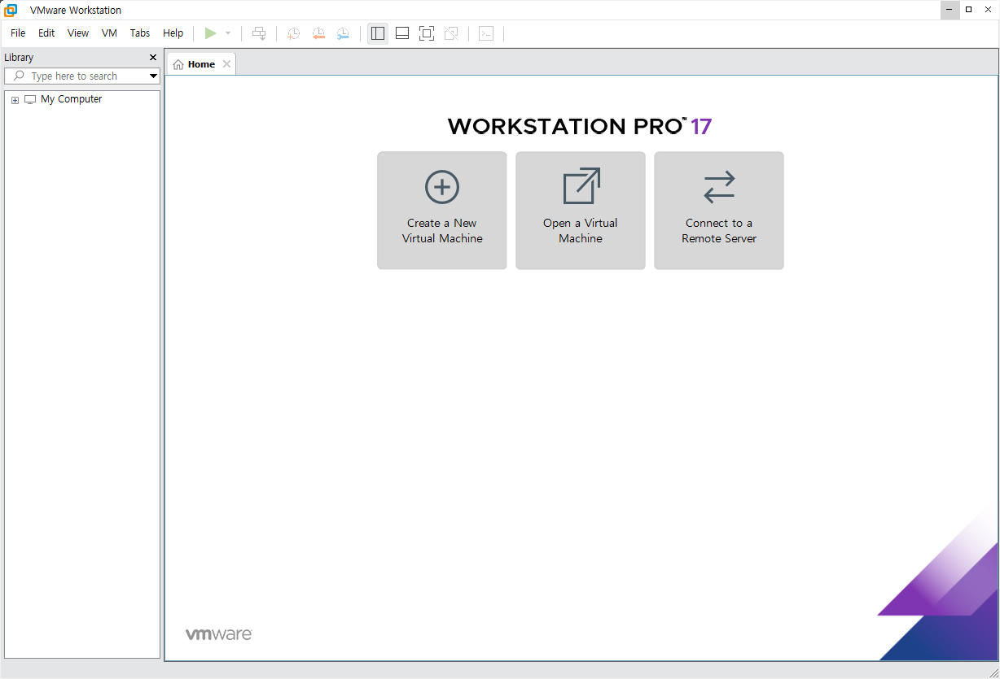
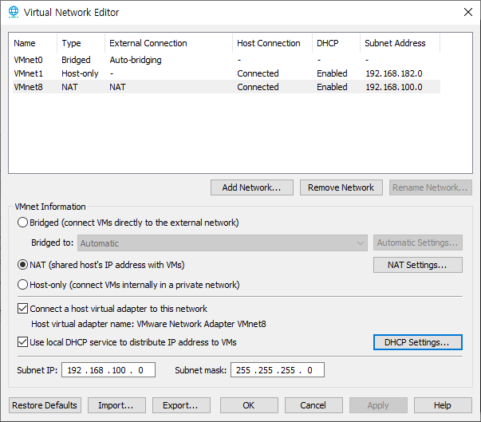

# WinSer with VMware

오늘은! **VMware**라는 가상머신으로 내 컴퓨터에 가상 컴퓨터를 만들어서! 그 위에 또 다른 서버 OS를 설치해보았다!

 

## 1. VMware 실행하기

첫 실행화면이다. 여기에서 가상머신을 실행하여 새로운 운영체제를 설치할 수 있다. 말하자면 이 창이 새로운 하나의 컴퓨터가 된다고 생각하면 편하다.

가장 먼저 해야할 작업은, 공인 IP를 변경하는 것이다. 강사님이 NAT 주소를 바꾸시길래 어째서 그렇게 하시나 찾아보니, 내가 **실제로 사용하는 컴퓨터도 동적할당된 IP를 사용하고, 가상머신도 동적할당된 IP를 사용하게 되면 서로 충돌**이 일어날 수도 있다고 한다. 그렇기에 가장 먼저 상단바의 Edit 버튼을 눌러 Virtual Network Editor로 들어간다.

NAT의 Subnet IP를 192.168.100.0으로 바꿨다. 이렇게만 해주면, VMware의 자체 설정은 끝난다.

설정이 끝났으니, 운영해야 할

